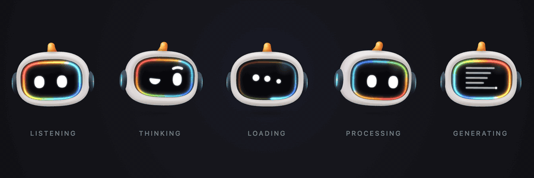
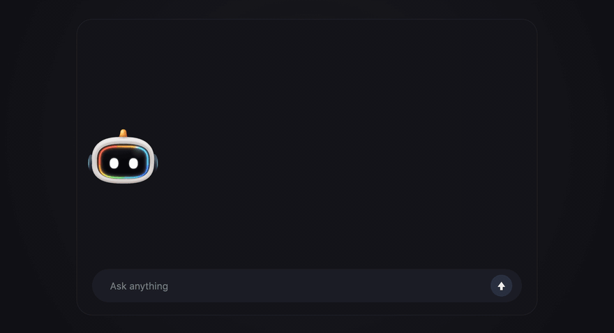
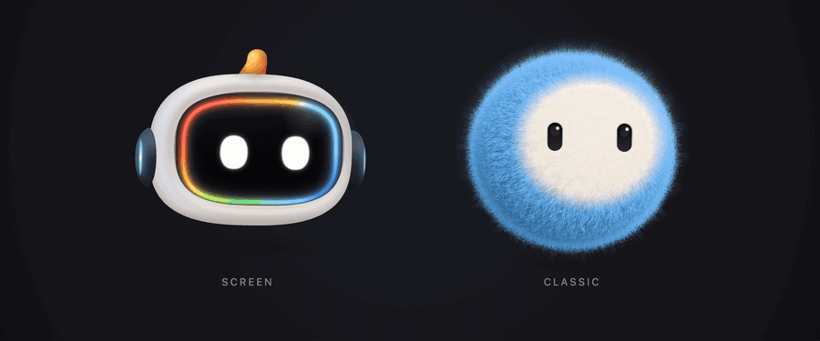
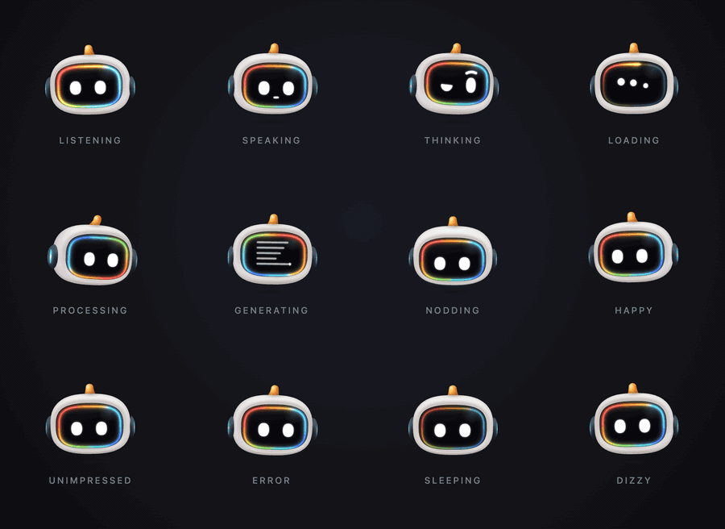
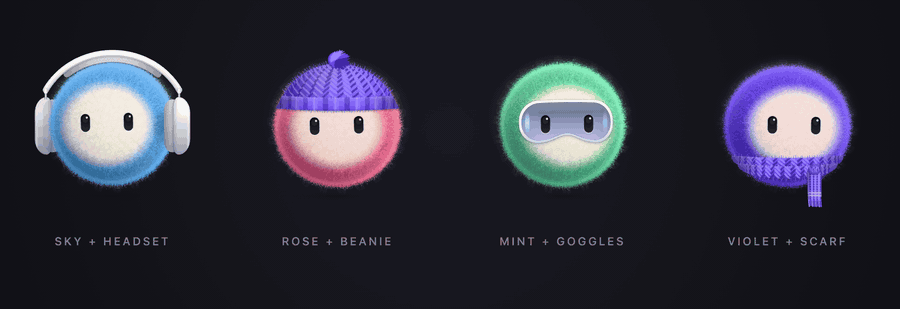

<div align="center">

<br>



<br>
<br>

# Robo

### A face for your AI.

Little robots that show what your AI is doing,<br>so waiting feels like watching someone work.

<br>

**[▶ &nbsp;Play with them live](https://roboavatar.vercel.app)**

<br>

</div>

---

## The problem

Ask an AI something and… nothing. A blank screen. A spinning circle.

Those few seconds are when people decide whether to trust it. A spinner says *"wait."* A face says *"I'm on it."*

## The idea

**Give your AI a face, and let the face do the talking.**

Robo listens when you type. It thinks. It goes off to read a dozen sources. Then it writes your answer, line by line, and gives a little nod when it's done. No explanation needed, anyone gets it at a glance.

<div align="center">

</div>

## Two characters

<div align="center">

</div>

<table>
<tr>
<td width="50%" valign="top">

### Screen
*The helper that gets things done.*

A glass face that shows its work: dots while it loads, a page writing itself while it creates, a ring of colour while it thinks hard.

</td>
<td width="50%" valign="top">

### Classic
*The friend that reacts.*

A soft, fluffy ball with big feelings. Pick its colour, give it a beanie or headphones, and it's yours.

</td>
</tr>
</table>

Both of them follow whatever you point at, blink, breathe and turn to look at you. They feel alive without ever getting in the way.

## Every mood, at a glance

<div align="center">

</div>

<br>

| When your AI is… | Robo… |
| --- | --- |
| **Listening** | leans in and brightens with your voice |
| **Thinking** | looks up, mid-thought |
| **Loading** | lets a comet of light run round its face |
| **Processing** | flows with colour while its eyes scan side to side |
| **Generating** | turns its face into a page and writes on it |
| **Saying yes** | nods, three times |
| **Done, stuck or asleep** | smiles, frowns, or dozes off |

Plus six quick reactions to play any time: love, proud, surprised, wink, excited, confused.

## Make it yours

<div align="center">

</div>

Pick a colour. Add a hat, goggles or headphones. Tune the fur. Your design is saved right in the link, so you can send it to a teammate and they see exactly what you made.

## Why you'll like it

- **Nothing to download.** No image files, no animation files. Robo draws itself, live, at any size, crisp on every screen.
- **Tiny.** About 45 KB, less than a single photo.
- **Kind to people.** It stops when it's off screen, and calms down for anyone who asks their device for less motion.
- **Private.** Nothing is recorded or sent anywhere.
- **Free.** Open source, yours to use in anything.

## Add it in a minute

Using React? This is the whole thing:

```tsx
import { RoboAvatar } from "robo-avatar/react";

<RoboAvatar size={64} state="thinking" />
```

Change `state` as your AI moves along, and Robo follows. Not a developer? Open the [playground](https://roboavatar.vercel.app), design your robot, and hand over the code it writes for you.

> Robo isn't on npm yet. Until it is, clone this repo, run `npm install && npm run build` inside the `robo` folder, and `npm link`.

## What's inside

| Folder | What's in it |
| --- | --- |
| `robo/` | Everything: the code, the playground and the tests |
| `assets/` | The animations on this page, made with Robo itself |

Run the playground on your own computer: `cd robo && npm install && npm run dev`.

<br>

<div align="center">

Designed and built by **[Upen](https://www.linkedin.com/in/upen-design/)**, a principal product designer who builds.<br>
Open source under the [MIT licence](LICENSE). Inspired by coucou's Mochi; no code is shared.

</div>
